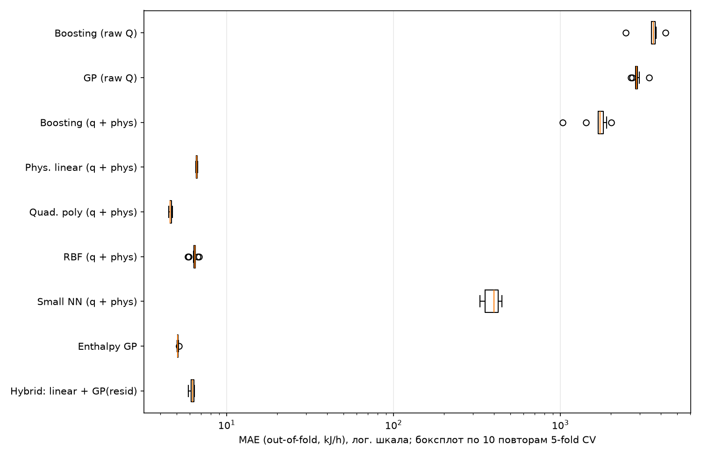
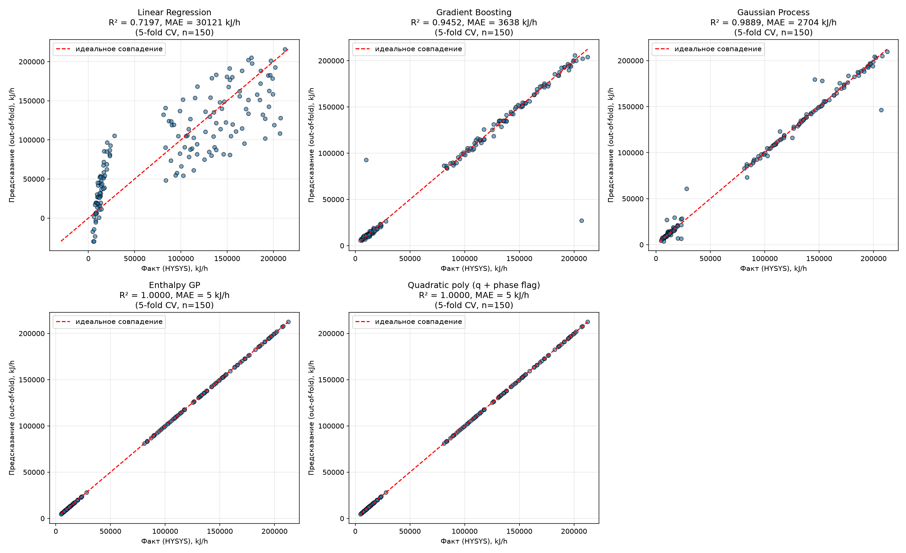

# Aspen HYSYS Heater Surrogate Model

A machine learning surrogate model for a simple Aspen HYSYS heater
(Water In → E-100 → Water Out). Automates data generation via Python/COM,
trains and validates a model that replaces repeated HYSYS runs for fast
what-if analysis — proof of concept for scaling the same approach to more
complex units (e.g. an FCC).

## Why

Process simulators like HYSYS are accurate but slow to query repeatedly.
A surrogate model learns the simulator's input-output behavior once, then
answers new queries in milliseconds instead of seconds — enabling
optimization, Monte Carlo analysis, and real-time operator advisory tools
that would be impractical running the full simulator thousands of times.

## HYSYS model

The source simulation case is in `hysys_case/heater_case.hsc` (Aspen HYSYS).
A simple Heater block (E-100) with a water stream (Water In → Water Out)
and its energy stream (Q-100) — the model `heater_01_generate_dataset.py`
drives via COM automation.

## Pipeline

1. **`src/heater_01_generate_dataset.py`** — connects to a running HYSYS
   case via COM automation (`pywin32`), samples the input space (T_in,
   Flow_in, T_out) using Latin Hypercube Sampling (DoE), and records the
   simulator's response. Output: `data/phase1_heater_dataset.xlsx`.
2. **`src/heater_02_train_model.py`** — trains and compares Linear
   Regression, Gradient Boosting, a plain Gaussian Process and the
   Enthalpy GP (below), evaluated with 5-fold cross-validation
   (out-of-fold predictions, not a single train/test split). An earlier
   `Dist_to_boiling_C = T_out - 100` feature was removed: it is `T_out`
   shifted by a constant, so it carries no new information (trees ignore the
   shift, and for linear regression it is a duplicate column).
3. **`src/heater_03_deploy_model.py`** — trains the final model (Enthalpy
   GP) on the full dataset and saves it to `models/surrogate_heater_model.pkl`.
   The model class and `predict_Q(T_in, Flow_in, T_out, return_std=False)`
   live in `src/surrogate_model.py`, shared by scripts 02–05.
4. **`src/heater_04_use_surrogate_batch.py`** — batch what-if / sensitivity
   analysis using the saved model (e.g. Q vs T_out across several T_in
   values), no HYSYS required.
5. **`src/heater_05_use_surrogate_interactive.py`** — interactive console
   querying of the saved model (enter T_in, Flow_in, T_out, get Q ± σ back
   instantly).
6. **`src/heater_06_optimize.py`** — optimization on top of the surrogate
   (`scipy.optimize.brentq`) under a conservative constraint
   `Q + 2σ <= Q_max`: maximum flow for a given T_out and heater limit, and
   maximum reachable T_out for a given flow (it reports when the limit falls
   short of the latent heat at 100 °C).

7. **`src/heater_07_extrapolation.py`** — trains on part of each input range
   and tests on the rest, for 7 models on equal footing (see Results).
8. **`src/heater_08_compare_models.py`** — 10 × repeated 5-fold CV with
   boxplots for six approaches (including a hybrid: physical linear model +
   GP on its residuals) and the uncertainty plot. `--plots-only` redraws
   only the uncertainty plot.

Besides `predict_Q`, `surrogate_model.py` provides
`predict_interval(…, k=2)` (mean ∓ kσ band, use the upper bound for
"not more than" constraints) and `is_trusted(…)`: true only if the input is
inside the training ranges **and** σ/Flow is below a threshold set at
training time (1.25 × the largest out-of-fold σ/Flow). On this dataset the
σ criterion adds little beyond the range check (σ is nearly flat inside the
box), but it also catches sparse regions of a denser or higher-dimensional
dataset.

`predict_Q` accepts scalars or numpy arrays (vectorized: 5,000 points in
~30 ms) and warns (`RuntimeWarning`) when an input is outside the training
ranges, which are stored in the model file. The sensitivity plot shows a
±2σ band.

## Results

| Model | R² (5-fold CV) | MAE (kJ/h) |
|---|---|---|
| Linear Regression | 0.71 | ~30,100 |
| Gradient Boosting  | 0.95 | ~3,600 |
| Gaussian Process (Matern 5/2, ARD) | 0.99 | ~2,700 |
| **Enthalpy GP** (deployed) | 1.00 | ~5 |

**Why a plain GP is not enough.** It is more accurate than Gradient
Boosting and its predictive std flags extrapolation, but it does **not**
flag the boiling-point step: in CV its std is nearly flat across T_out
(~5,000 kJ/h) while the real error at T_out 98–102 °C is ~22,000 kJ/h
(correlation of std and error: 0.07). A stationary kernel cannot represent
a step.

**Enthalpy GP.** Since Q = m·(h_out − h_in), the specific heat duty
q = Q / Flow depends only on the temperatures (checked on the data: the
flow coefficient is ≈ 0, and dq/dT_out ≈ 4.2 kJ/kg/K in the liquid, i.e.
cp of water). The GP is therefore trained on q with features
`[T_in, T_out, is_vapor]`, where `is_vapor = T_out >= 100 °C`; the latent
heat jump lives entirely in that flag, and the smooth part is left to the
GP. Result: R² = 1.0000, MAE ≈ 5 kJ/h in 5-fold CV, with similar error in
every T_out band including 98–102 °C. The predictive std (~200 kJ/h) is
conservative (real errors are ~5 kJ/h) but uniform and no longer misleading;
it still grows when extrapolating (e.g. ~1,600 kJ/h at T_out = 300 °C).
This is not the removed `Dist_to_boiling_C`: a step flag carries information
a constant shift does not.

### Extrapolation test (`heater_07_extrapolation.py`)

Random k-fold CV only tests interpolation, so models are also trained on
part of the range and tested on the rest. All "phys" models get the same
target q = Q/Flow and features `[T_in, T_out, is_vapor, max(0, T_out−100)]`,
so the comparison is not confounded by feature engineering. Test MAE, kJ/h:

| Model | Flow 30–60 → 60–80 | T_in ≤30 → >30 | T_out ≤130 → >130 |
|---|---|---|---|
| Linear (raw Q) | 45,600 | 28,500 | 57,700 |
| Boosting (raw Q) | 19,400 | 8,300 | 3,100 |
| GP (raw Q) | 17,100 | 5,700 | 59,500 |
| Boosting (q + phys) | 2,800 | 4,100 | 2,000 |
| Physical linear (q + phys) | 7.7 | 6.7 | 25.5 |
| **Enthalpy GP** | **5.8** | **5.4** | **7.0** |
| Enthalpy GP + kink feature | 5.8 | 5.4 | 7.0 |

Findings:
- **The physics, not the model class, does most of the work.** Predicting
  q = Q/Flow with a phase flag takes every model from 10³–10⁴ kJ/h error to
  ~10 kJ/h or better. A plain linear model on those features is already
  within a few kJ/h of the GP.
- **Trees fail to extrapolate even with the physics** (2,000–4,000 kJ/h),
  as expected: they cannot continue a trend. Raw boosting did surprisingly
  well on the T_out split (3,100), where Q changes slowly with T_out in
  vapor, but is 10³× worse on Flow and T_in.
- **The `max(0, T_out−100)` kink feature gave no gain** for the GP (identical
  to 3 digits); it stays an optional parameter (`use_kink`), off by default.
- The GP is kept as the deployed model because it is the most accurate on the
  hardest split and provides σ, but a linear physical model is a legitimate,
  simpler alternative. Caveat: this is a clean, nearly linear system with
  noise-free simulator output; the ranking may not carry over to the FCC.


### Repeated CV and the hybrid (`heater_08_compare_models.py`)

Median out-of-fold MAE over 10 repeats of 5-fold CV (min–max in brackets):

| Model | MAE, kJ/h | R² |
|---|---|---|
| Boosting (raw Q) | 3,600 (2,460–4,270) | 0.944 |
| GP (raw Q) | 2,850 (2,650–3,400) | 0.987 |
| Boosting (q + phys) | 1,730 (1,040–2,020) | 0.967 |
| Physical linear (q + phys) | 6.6 (6.5–6.7) | 1.0000 |
| **Enthalpy GP** | **5.1 (5.0–5.2)** | 1.0000 |
| Hybrid: linear + GP(resid) | 6.2 (5.9–6.4) | 1.0000 |



- The three physical models are statistically indistinguishable in
  practice (5–7 kJ/h, spread between repeats < 0.5 kJ/h) and 2–3 orders of
  magnitude ahead of everything on raw Q. The GP is marginally best, the
  hybrid does not beat it: the physical linear part already explains
  almost everything, so there is little left for the residual GP.
- Boosting with physics is still ~1,700 kJ/h with a wide spread: trees
  cannot represent the near-linear dependence on T_out and T_in precisely.


What the uncertainty plot shows (σ at Flow = 55, T_in = 25):
- **GP on raw Q** cannot represent the step: it draws a smooth sigmoid across
  97.5–102 °C, and outside the training range its mean reverts to the prior
  with a huge σ (the "reversion" behavior).
- **Enthalpy GP**: 2σ ≈ 420 kJ/h, almost flat inside the box (so a flat σ
  does not by itself mark regions of higher error), growing only far outside
  (σ ≈ 520 kJ/h at 220 °C, 1,750 kJ/h at 300 °C). It is ~70× larger than the
  real error (~6 kJ/h): safe, but pessimistic.
- **Hybrid**: 2σ ≈ 5–20 kJ/h, close to the real error, but it barely grows
  outside the box, because the residual GP reverts to zero while the linear
  part keeps extrapolating. Better calibrated inside, not an extrapolation
  detector. Use the range check (`is_trusted`) with it.




## Known limitations

- **Phase-change point.** Exactly at the boiling point, a temperature-and-
  pressure specification does not determine vapor fraction (the stream sits
  on the saturation line), so the true value is ambiguous. The Enthalpy GP
  handles it with a hard threshold `T_out >= T_sat` (100 °C); the nearest
  training points are at 99.9 and 100.4 °C, so within a few tenths of a
  degree of the threshold the result is only as good as that convention.
- **Fixed pressure.** `T_sat = 100 °C` is a constant (the case runs at
  ~101 kPa). A different pressure needs a new T_sat and regenerated data.
- **Extrapolation is tested only inside the sampled box.** The model was
  trained on T_in ≈ 10–40 °C, T_out ≈ 60–160 °C, flow ≈ 30–80 kg/h (150 LHS
  points). The range-split test (below) holds out the upper part of each
  variable and the Enthalpy GP stays at MAE ≈ 6–7 kJ/h. That does **not**
  cover the liquid-to-vapor regime change (never held out) or inputs far
  outside the box, and there the GP std is the only warning: it grows far
  from the data (~1,600 kJ/h at T_out = 300 °C) but stays flat (~250 kJ/h)
  in the held-out slices above, so it is not a sharp extrapolation detector.
  `predict_Q` additionally warns when an input leaves the training range.
- **Heater-specific trick.** Dividing by flow and the phase flag use known
  physics of this unit; the same recipe for an FCC would need its own
  physics-informed target and features.

## How to run

```bash
pip install -r requirements.txt

# with HYSYS open and the heater model loaded:
python src/heater_01_generate_dataset.py
python src/heater_02_train_model.py
python src/heater_03_deploy_model.py

# afterwards, HYSYS is no longer required:
python src/heater_04_use_surrogate_batch.py
python src/heater_05_use_surrogate_interactive.py
python src/heater_06_optimize.py
python src/heater_07_extrapolation.py
```

## Roadmap

- Scale the same pipeline to a more complex unit (FCC).
- Multi-variable optimization (e.g. cost of Q vs throughput) with
  `scipy.optimize.minimize`; the current script solves 1-D problems only.