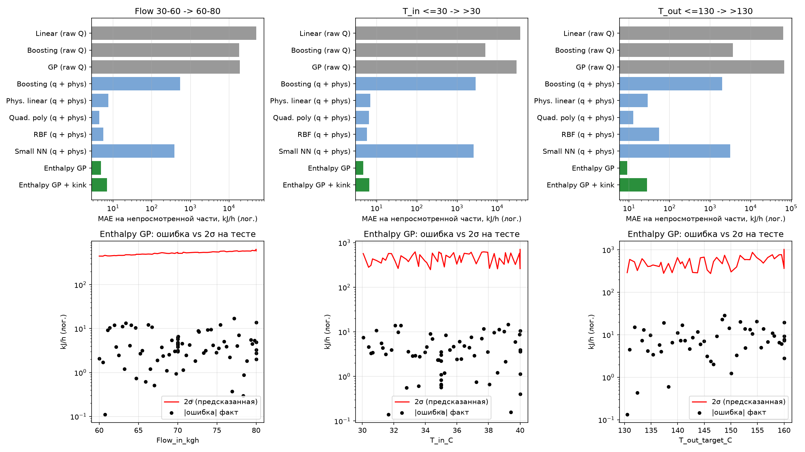
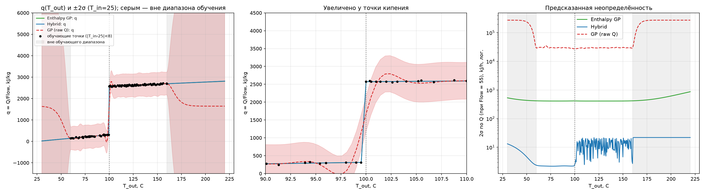
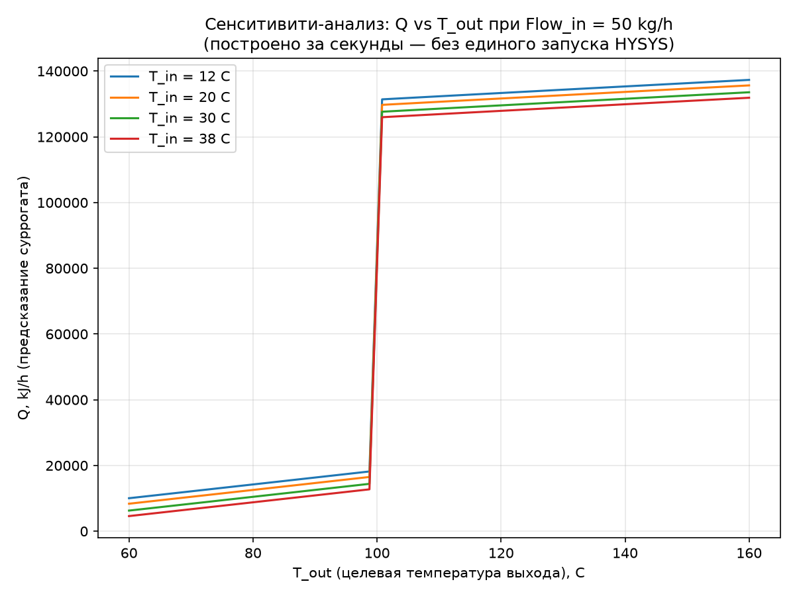

# Aspen HYSYS Heater Surrogate Model

A machine learning surrogate model for a simple Aspen HYSYS heater
(Water In → E-100 → Water Out). Automates data generation via Python/COM,
trains and validates models that replace repeated HYSYS runs for fast
what-if analysis — proof of concept for scaling the same approach to more
complex units (e.g. an FCC).

**Headline result.** Predicting the *specific* heat duty q = Q / Flow with a
phase flag cuts the error from ~3,000 kJ/h to ~5 kJ/h (R² = 1.0000) and keeps
it at 6–7 kJ/h when extrapolating to input ranges the model never saw. The
physics in the target and features matters far more than the model class.

## Why

Process simulators like HYSYS are accurate but slow to query repeatedly.
A surrogate model learns the simulator's input-output behavior once, then
answers new queries in milliseconds instead of seconds — enabling
optimization, Monte Carlo analysis, and real-time operator advisory tools
that would be impractical running the full simulator thousands of times.

## HYSYS model

The source simulation case is in
[`hysys_case/Heater_case.hsc`](hysys_case/Heater_case.hsc) (Aspen HYSYS).
A simple Heater block (E-100) with a water stream (Water In → Water Out)
and its energy stream (Q-100) — the model `heater_01_generate_dataset.py`
drives via COM automation. Inputs: T_in, Flow_in, T_out; output: heat duty Q.

## Results

All numbers come from `data/phase1_heater_dataset.xlsx` (150 Latin Hypercube
points, T_in ≈ 10–40 °C, flow ≈ 30–80 kg/h, T_out ≈ 60–160 °C, ~101 kPa).
"phys" models get the same target q = Q/Flow and features
`[T_in, T_out, is_vapor, max(0, T_out−100)]`, so the comparison is not
confounded by feature engineering.

| Model | Interpolation: MAE, kJ/h (10×5-fold CV, median) | Extrapolation: worst-case MAE, kJ/h (range-split) |
|---|---|---|
| Linear Regression (raw Q) | ~30,100 ¹ | 57,700 |
| Gradient Boosting (raw Q) | 3,600 | 19,400 |
| Gaussian Process (raw Q) | 2,850 | 59,500 |
| Gradient Boosting (q + phys) | 1,730 | 4,100 |
| Physical linear (q + phys) | 6.6 | 25.5 |
| **Enthalpy GP** (deployed) | **5.1** | **7.0** |
| Hybrid: linear + GP on residuals | 6.2 | not tested |

¹ single 5-fold CV (R² = 0.71); the other rows are medians over 10 repeats.


### How the Enthalpy GP works

Since Q = m·(h_out − h_in), the specific heat duty q = Q / Flow depends only
on the temperatures. Checked on the data: the flow coefficient is ≈ 0, and
dq/dT_out ≈ 4.2 kJ/kg/K in the liquid (cp of water). The GP is therefore
trained on q with features `[T_in, T_out, is_vapor]`, where
`is_vapor = T_out >= 100 °C`. The latent-heat jump lives entirely in that
flag (the simulator's vapor fraction flips exactly at 100 °C in the data), and
the smooth part is left to the GP. Final Q = q · Flow.

A plain GP on raw Q cannot do this: it smooths the step into a sigmoid across
97.5–102 °C, and its predictive std is nearly flat (~5,000 kJ/h) while the real
error at 98–102 °C is ~22,000 kJ/h (correlation of std and error: 0.07).

### Extrapolation test (`heater_07_extrapolation.py`)

Random k-fold CV only tests interpolation, so models are also trained on part
of the range and tested on the rest. Test MAE, kJ/h:

| Model | Flow 30–60 → 60–80 | T_in ≤30 → >30 | T_out ≤130 → >130 |
|---|---|---|---|
| Linear (raw Q) | 45,600 | 28,500 | 57,700 |
| Boosting (raw Q) | 19,400 | 8,300 | 3,100 |
| GP (raw Q) | 17,100 | 5,700 | 59,500 |
| Boosting (q + phys) | 2,800 | 4,100 | 2,000 |
| Physical linear (q + phys) | 7.7 | 6.7 | 25.5 |
| **Enthalpy GP** | **5.8** | **5.4** | **7.0** |
| Enthalpy GP + kink feature | 5.8 | 5.4 | 7.0 |



- Trees fail to extrapolate even with the physics (2,000–4,000 kJ/h): they
  cannot continue a trend. Raw boosting did surprisingly well on the T_out
  split (3,100), where Q changes slowly with T_out in vapor, but gives
  19,400 and 8,300 kJ/h on the Flow and T_in splits.
- The `max(0, T_out−100)` kink feature gave no gain for the GP (identical to
  3 digits); it stays an optional parameter (`use_kink`), off by default.
- The GP is kept as the deployed model because it is the most accurate on the
  hardest split and provides σ, but the physical linear model is a legitimate,
  simpler alternative.

### Uncertainty



σ shown at Flow = 55 kg/h, T_in = 25 °C:
- **GP on raw Q** draws a smooth sigmoid across the step, and outside the
  training range its mean reverts to the prior with a huge σ.
- **Enthalpy GP**: 2σ ≈ 420 kJ/h, almost flat inside the box, growing only
  far outside (σ ≈ 520 kJ/h at 220 °C, 1,750 kJ/h at 300 °C). It is ~70×
  larger than the real error (~6 kJ/h): safe, but pessimistic. A flat σ does
  not mark regions of higher error.
- **Hybrid** (linear + GP on residuals): 2σ ≈ 5–20 kJ/h, close to the real
  error, but it barely grows outside the box because the residual GP reverts
  to zero while the linear part keeps extrapolating. Better calibrated inside,
  not an extrapolation detector. Use the range check (`is_trusted`) with it.

### Other plots




## What we learned

1. **A feature must carry new information.** `T_out − 100` is `T_out` shifted
   by a constant: trees ignore the shift, and for a linear model it is a
   duplicate column, so it was removed with no change in metrics. The phase
   flag `T_out >= 100` is a step, which no smooth function of T_out supplies,
   and it is what removed the boiling-point error. (A kink feature
   `max(0, T_out−100)` was tested too and added nothing on top of the flag.)
2. **Put known structure into the model.** Q = m·Δh means "learn the specific
   quantity, then multiply". This single change took every model from 10³–10⁴
   kJ/h to ~10 kJ/h or better, more than any choice of algorithm.
3. **Evaluate on data the model has not seen, and test extrapolation
   separately.** R² = 1.0000 in random CV is interpolation. Range-split
   tests are what separated the models.
4. **Trees do not continue trends.** Even with the right features, boosting
   stays at 10³ kJ/h when extrapolating; smooth and physical models do not.
5. **Check that writing an input really changes the calculation.** Writing
   a value through COM can fail silently, and a surrogate trained on such
   data learns nothing about that input. Here the dataset records the achieved
   T_out next to the target and they match exactly (max difference 0.0 °C over
   all 150 points); T_in and flow have no such read-back column and are not
   verified this way.
6. **Compare models on equal terms.** Giving only the GP the physical features
   would have mixed "better algorithm" with "better features". Boosting and
   the linear model got the same q and features.
7. **Do not trust σ blindly.** A GP's σ depends on the kernel: the plain GP's
   σ ignored the step, the Enthalpy GP's is flat inside the box and ~70×
   pessimistic, the hybrid's is close to the real error but does not grow
   outside. Calibrate σ against actual errors, and keep an explicit range
   check next to it.

## Pipeline

1. **`src/heater_01_generate_dataset.py`** — connects to a running HYSYS
   case via COM automation (`pywin32`), samples the input space (T_in,
   Flow_in, T_out) using Latin Hypercube Sampling (DoE), and records the
   simulator's response. Output: `data/phase1_heater_dataset.xlsx`.
2. **`src/heater_02_train_model.py`** — trains and compares Linear Regression,
   Gradient Boosting, a plain Gaussian Process and the Enthalpy GP with 5-fold
   cross-validation (out-of-fold predictions, not a single train/test split).
3. **`src/heater_03_deploy_model.py`** — trains the final model (Enthalpy GP)
   on the full dataset, stores training ranges and the σ trust threshold, and
   saves it to `models/surrogate_heater_model.pkl`.
4. **`src/heater_04_use_surrogate_batch.py`** — batch what-if / sensitivity
   analysis with a ±2σ band, no HYSYS required.
5. **`src/heater_05_use_surrogate_interactive.py`** — interactive console
   querying (enter T_in, Flow_in, T_out, get Q ± σ back instantly).
6. **`src/heater_06_optimize.py`** — optimization on top of the surrogate
   (`scipy.optimize.brentq`) under a conservative constraint
   `Q + 2σ <= Q_max`: maximum flow for a given T_out and heater limit, and
   maximum reachable T_out for a given flow (it reports when the limit falls
   short of the latent heat at 100 °C).
7. **`src/heater_07_extrapolation.py`** — trains on part of each input range
   and tests on the rest, for 7 models on equal footing.
8. **`src/heater_08_compare_models.py`** — 10 × repeated 5-fold CV with
   boxplots for six approaches (including the hybrid) and the uncertainty
   plot. `--plots-only` redraws only the uncertainty plot.

### Using the surrogate from your own code

`src/surrogate_model.py` holds the model class and the public API (run from
`src/`, or add it to `sys.path`):

```python
from surrogate_model import predict_Q, predict_interval, is_trusted

q = predict_Q(20.0, 50.0, 130.0)                       # kJ/h
q, sigma = predict_Q(20.0, 50.0, 130.0, return_std=True)
q_arr = predict_Q(20.0, 50.0, t_out_array)             # numpy arrays: vectorized
lo, hi = predict_interval(20.0, 50.0, 130.0, k=2)      # mean ∓ kσ band
ok = is_trusted(20.0, 50.0, 130.0)                     # True / False (or array)
```

- `predict_Q` accepts scalars or numpy arrays (5,000 points in ~30 ms) and
  warns (`RuntimeWarning`) when an input is outside the training ranges,
  which are stored in the model file.
- `predict_interval` gives the mean ∓ kσ band; use the upper bound for
  "not more than" constraints.
- `is_trusted` is true only if the input is inside the training ranges **and**
  σ/Flow is below a threshold set at training time (1.25 × the largest
  out-of-fold σ/Flow). On this dataset the σ criterion adds little beyond the
  range check, because σ is nearly flat inside the box.

## Known limitations

- **Phase-change point.** Exactly at the boiling point, a temperature-and-
  pressure specification does not determine vapor fraction (the stream sits
  on the saturation line), so the true value is ambiguous. The Enthalpy GP
  handles it with a hard threshold `T_out >= T_sat` (100 °C); only 6 of the 150
  training points lie in 98–102 °C, the nearest at 99.9 and 100.4 °C, so
  within a few tenths of a degree of the threshold the result is only as good
  as that convention.
- **Fixed pressure.** `T_sat = 100 °C` is a constant (the case runs at
  ~101 kPa). A different pressure needs a new T_sat and regenerated data.
- **Extrapolation is tested only inside the sampled box.** The range-split
  test holds out the upper part of each variable, not the liquid-to-vapor
  regime change and not inputs far outside the box. There the GP σ is the
  only quantitative warning, and it is not a sharp detector (flat ~250 kJ/h in
  the held-out slices). `predict_Q` warns when an input leaves the training
  range; `is_trusted` combines both checks.
- **Heater-specific trick.** Dividing by flow and the phase flag use known
  physics of this unit; the same recipe for an FCC would need its own
  physics-informed target and features. The model ranking was obtained on a
  clean, nearly linear, noise-free simulator output and may not carry over.

## How to run

```bash
pip install -r requirements.txt

# with HYSYS open and the heater model loaded:
python src/heater_01_generate_dataset.py
python src/heater_02_train_model.py
python src/heater_03_deploy_model.py

# afterwards, HYSYS is no longer required:
python src/heater_04_use_surrogate_batch.py
python src/heater_05_use_surrogate_interactive.py
python src/heater_06_optimize.py
python src/heater_07_extrapolation.py
python src/heater_08_compare_models.py     # several minutes (repeated CV with GPs)
```

## Roadmap

- Scale the same pipeline to a more complex unit (FCC).
- Improve the experimental design (DoE): add points around 100 °C and in the
  corners of the domain, compare LHS against adaptive sampling (needs HYSYS
  and changes to `heater_01`).
- Extra models for comparison: RBF, a small neural network, a quadratic
  polynomial.
- Multi-variable optimization (e.g. cost of Q vs throughput) with
  `scipy.optimize.minimize`; the current script solves 1-D problems only.
