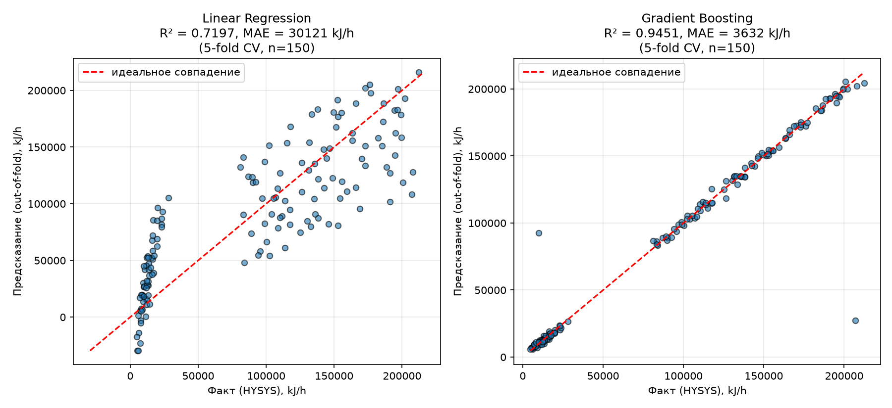
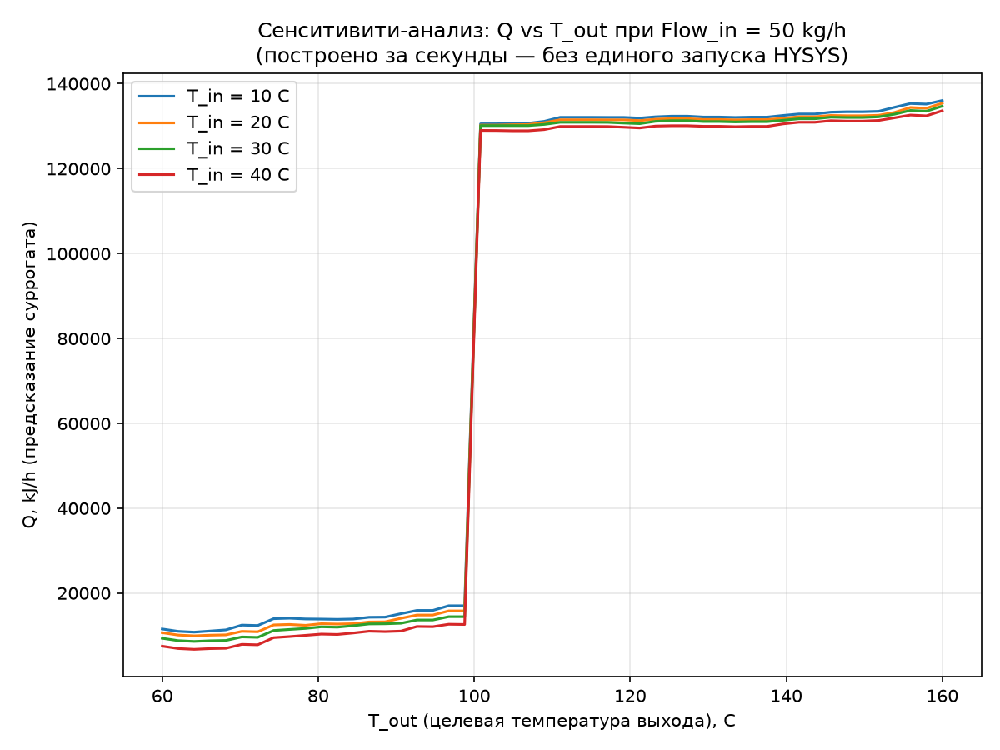

# Aspen HYSYS Heater Surrogate Model

A machine learning surrogate model for a simple Aspen HYSYS heater
(Water In → E-100 → Water Out). Automates data generation via Python/COM,
trains and validates a model that replaces repeated HYSYS runs for fast
what-if analysis — proof of concept for scaling the same approach to more
complex units (e.g. an FCC).

## Why

Process simulators like HYSYS are accurate but slow to query repeatedly.
A surrogate model learns the simulator's input-output behavior once, then
answers new queries in milliseconds instead of seconds — enabling
optimization, Monte Carlo analysis, and real-time operator advisory tools
that would be impractical running the full simulator thousands of times.

## Pipeline

1. **`src/heater_01_generate_dataset.py`** — connects to a running HYSYS
   case via COM automation (`pywin32`), samples the input space (T_in,
   Flow_in, T_out) using Latin Hypercube Sampling (DoE), and records the
   simulator's response. Output: `data/phase1_heater_dataset.xlsx`.
2. **`src/heater_02_train_model.py`** — trains and compares Linear
   Regression and Gradient Boosting, evaluated with 5-fold cross-validation
   (out-of-fold predictions, not a single train/test split). Includes an
   engineered `Dist_to_boiling_C` feature to help the model separate the
   liquid and vapor regimes around the phase-change point.
3. **`src/heater_03_deploy_model.py`** — trains the final model on the
   full dataset and saves it to `models/surrogate_heater_model.pkl`.
4. **`src/heater_04_use_surrogate_batch.py`** — batch what-if / sensitivity
   analysis using the saved model (e.g. Q vs T_out across several T_in
   values), no HYSYS required.
5. **`src/heater_05_use_surrogate_interactive.py`** — interactive console
   querying of the saved model (enter T_in, Flow_in, T_out, get Q back
   instantly).

## Results

| Model | R² (5-fold CV) | MAE (kJ/h) |
|---|---|---|
| Linear Regression | 0.71 | ~30,100 |
| Gradient Boosting  | 0.95 | ~3,600 |




## Known limitations

- **Phase-change discontinuity.** Near the water's boiling point, a
  temperature-and-pressure specification no longer uniquely determines
  vapor fraction (the stream sits on the saturation line). The underlying
  relationship has a genuine step discontinuity there, which no regression
  model can represent exactly at that single point. The `Dist_to_boiling_C`
  feature helps the model separate the two regimes nearby, but predictions
  queried exactly at the boiling point should not be trusted.
- **No extrapolation beyond the training domain.** The model was trained
  on inputs within specific ranges (e.g. mass flow 30–80 kg/h, later
  widened to 150 LHS points). Tree-based models like Gradient Boosting
  cannot extrapolate past the ranges they were trained on — queries outside
  that domain silently degrade in accuracy. Always check inputs against the
  ranges used in `heater_01_generate_dataset.py`.

## How to run

```bash
pip install -r requirements.txt

# with HYSYS open and the heater model loaded:
python src/heater_01_generate_dataset.py
python src/heater_02_train_model.py
python src/heater_03_deploy_model.py

# afterwards, HYSYS is no longer required:
python src/heater_04_use_surrogate_batch.py
python src/heater_05_use_surrogate_interactive.py
```

## Roadmap

- Scale the same pipeline to a more complex unit (FCC).
- Replace Gradient Boosting with Gaussian Process Regression to get
  uncertainty estimates alongside predictions (flagging low-confidence
  regions, such as near the phase-change boundary, automatically).
- Wrap the surrogate in an optimization loop (e.g. `scipy.optimize`) for
  real what-if decision support.